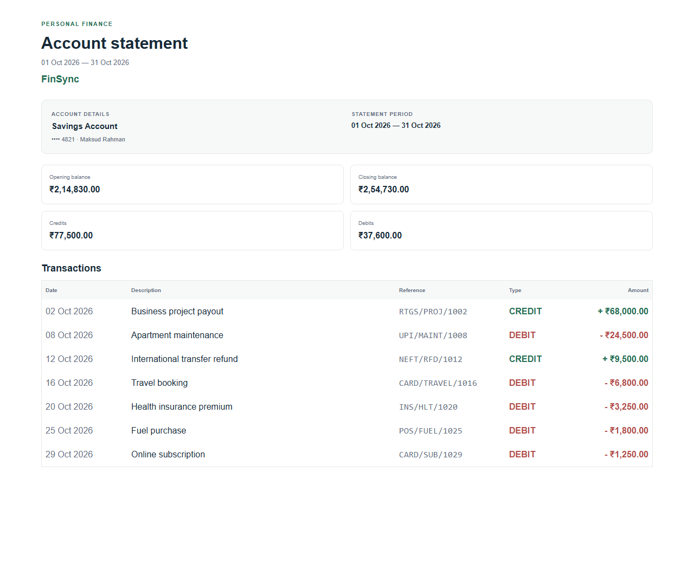
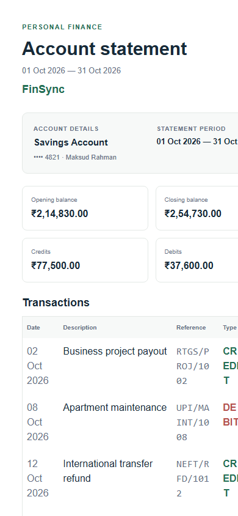
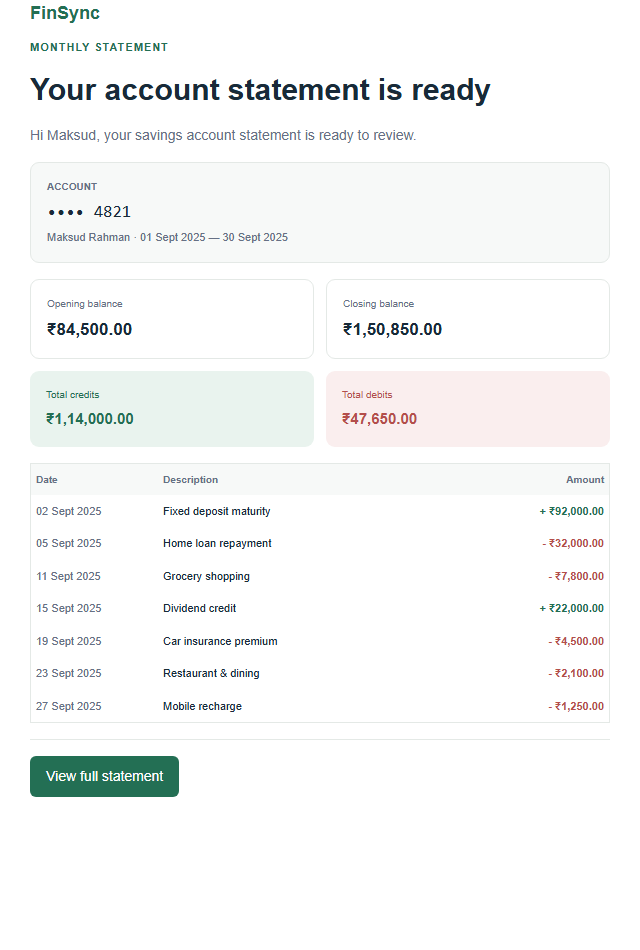
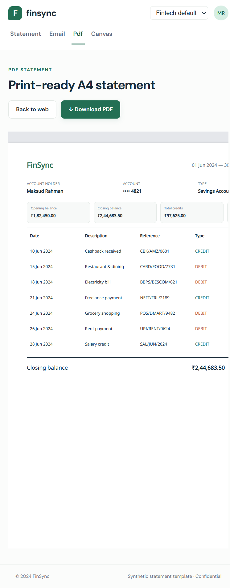
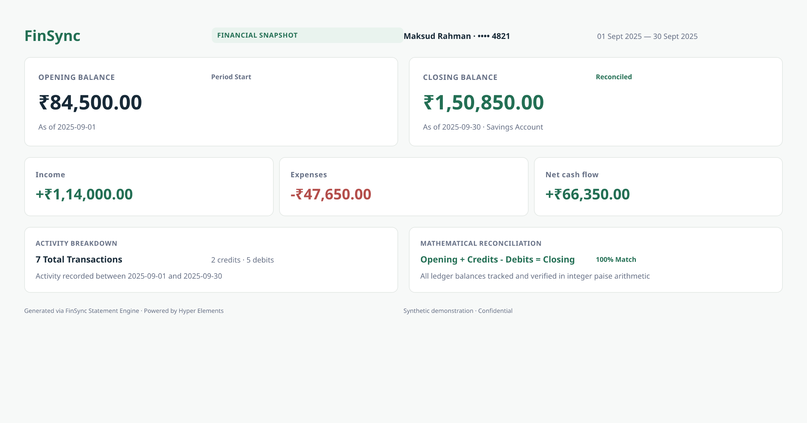
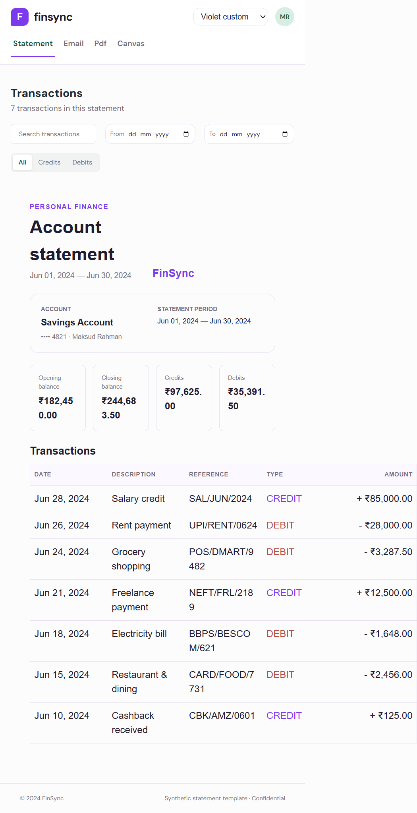
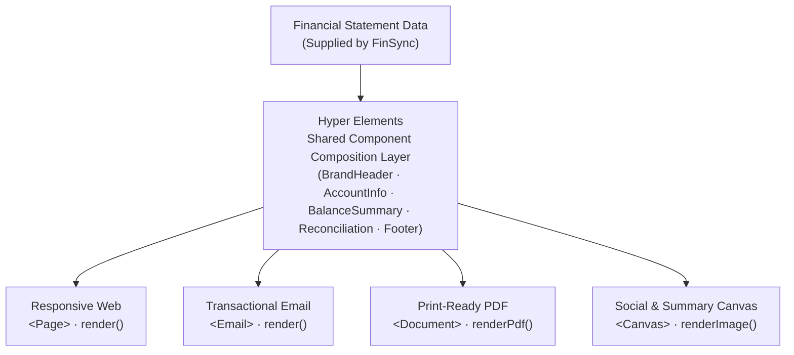

# FinSync

> **One financial statement. Four purpose-built formats. Powered by Hyper Elements.**

[](https://react.dev)
[](https://www.typescriptlang.org)
[](https://github.com/hyper-elements/hyper-elements)
[](https://vitejs.dev)
[](https://vitest.dev)

FinSync is a reusable developer template built with **React**, **TypeScript**, and **[@hyper-elements/react@0.5.0](https://github.com/hyper-elements/hyper-elements)**. It demonstrates how a single, strongly-typed financial statement dataset compiles into four production-grade output media: **Responsive Web**, **Transactional Email**, **Print-Ready PDF**, and **Social / Dashboard Canvas**.

[Live Demo](#quick-start) · [Architecture Guide](docs/ARCHITECTURE.md) · [Developer Guide](docs/DEVELOPER_GUIDE.md) · [API Reference](docs/API_REFERENCE.md) · [Customization Guide](docs/CUSTOMIZATION.md) · [Examples](docs/EXAMPLES.md)

---

## 1. Project Overview

In standard software engineering, delivering financial statements across customer channels requires building and maintaining separate presentation systems:
- **Web Portals**: HTML/CSS grid dashboards built with standard web frameworks.
- **Email Notifications**: Table-based HTML with inlined CSS (`<table>`, `<tr>`, `<td>`, MSO conditionals) to avoid email client rendering bugs.
- **Downloadable Statements**: Headless browser printing (Puppeteer) or custom PDF rendering engines (`@react-pdf/renderer`).
- **Executive Summaries**: Image composition libraries (Satori, Canvas) for shareable cards and social previews.

This fragmentation forces engineering teams to duplicate financial business logic, recalculate ledger totals in multiple places, and constantly reconcile styling discrepancies across channels.

### How FinSync Solves This

FinSync models financial statements once using a typed data structure (`Statement`) and declarative, reusable components (`BrandHeader`, `AccountInformation`, `BalanceSummary`, `TransactionSection`, `ReconciliationBanner`, `StatementFooter`). 

Using Hyper Elements v0.5.0, these shared components are composed into format-specific document roots:
- `<Page>`: Compiles to clean, responsive web HTML with scoped styles.
- `<Email>`: Compiles to client-safe, table-based HTML with inlined styles and MSO fallbacks.
- `<Document>`: Compiles to vector A4 PDF documents with embedded TrueType fonts and dynamic page numbering.
- `<Canvas>`: Compiles to high-resolution raster images (1200×630 at 2× scale) for social sharing and executive previews.

### Who Can Reuse FinSync?

FinSync is designed as a template for:
- **Fintech SaaS & Neobanks**: Generating monthly customer statements, email balance summaries, and downloadable audit PDFs.
- **Billing & Invoicing Platforms**: Producing multi-format receipts and reconciliation sheets.
- **Wealth Management Portals**: Providing portfolio summaries and shareable performance cards.
- **Enterprise ERPs**: Delivering multi-channel ledger reporting without duplicating front-end template code.

---

## 2. See FinSync in Action

FinSync renders four distinct, medium-tailored outputs from the exact same synthetic statement data:

| Output Format | Target Medium | Visual Preview |
| :--- | :--- | :--- |
| **Responsive Web** | Desktop browser dashboard | [](docs/screenshots/final/web-desktop-1280x1050.png)<br/>*Interactive web statement with responsive layout, type filters, and date range search.* |
| **Mobile Web** | Smartphone viewports | [](docs/screenshots/final/web-mobile-390x844.png)<br/>*Compact mobile view with responsive card wrapping and fluid typography.* |
| **Transactional Email** | Mail clients (Outlook, Gmail, Apple Mail) | [](docs/screenshots/final/email-preview-640x950.png)<br/>*Client-safe table layout with inlined CSS, key summary metrics, and a direct web CTA.* |
| **Print-Ready PDF** | Archival A4 document download | [](docs/screenshots/final/pdf-preview.png)<br/>*Multi-page paginated A4 PDF with running ledger balances, embedded Noto Sans fonts, and footer page counters.* |
| **Canvas Snapshot** | Social cards & executive previews | [](docs/screenshots/final/canvas-summary-1200x630.png)<br/>*1200×630 high-contrast snapshot featuring opening/closing balances, net cash flow, and activity insights.* |
| **Themed Customization** | White-label enterprise branding | [](docs/screenshots/final/custom-theme.png)<br/>*Live theme switching demonstrating external corporate identities (e.g. Acme Finance).* |

---

## 3. Key Capabilities

- **Four Output Formats from One Source**: Eliminates template divergence by compiling a single statement dataset into Web HTML, Email HTML, vector PDF, and raster PNG.
- **Integer Paise Financial Arithmetic**: All calculations (credits, debits, running balances, opening and closing balances) operate strictly in integer paise (`1 INR = 100 paise`), eliminating IEEE 754 floating-point inaccuracies.
- **Automated Mathematical Reconciliation**: Verifies that $\text{Opening Balance} + \sum\text{Credits} - \sum\text{Debits} = \text{Closing Balance}$. If any discrepancy is detected, a prominent `ReconciliationBanner` renders across all four formats.
- **Running Ledger Balances**: Calculates cumulative running balances for each transaction entry in sequence, surfaced in both the interactive web view and the official PDF statement.
- **Privacy & Account Masking**: Automatically masks account numbers (e.g., `•••• 4821`) and formats dates and currencies according to regional locale standards (`en-IN` and `en-US`).
- **Tokenized Theme Customization**: Customizes primary colors, surfaces, text ink, borders, spacing scales, and corner radii through typed configuration objects (`FinSyncPresentationConfig`).
- **Portable Font Embedding**: Bundles SIL Open Font License TrueType fonts (`Noto Sans Regular` and `Noto Sans Bold`), ensuring PDF and Canvas outputs render identically regardless of host OS fonts.
- **Hardened Export Pipeline**: Includes a Node.js export microservice enforcing request payload limits (2 MB), filename sanitization to prevent path traversal, and UTF-8 BOM stripping.

---

## 4. How It Works

FinSync separates data ingestion and financial verification from visual document composition. FinSync supplies the normalized statement data and uses Hyper Elements to compose and render each document:



### Component Reuse Matrix

The shared semantic components under `src/components/` adapt cleanly across the four output media:

| Component | Web (`Page`) | Email (`Email`) | PDF (`Document`) | Canvas (`Canvas`) | Format Adaptation |
| :--- | :---: | :---: | :---: | :---: | :--- |
| **`BrandHeader`** | Yes (`standard`) | Yes (`email`) | Yes (`compact`) | Yes (`canvas`) | Adapts logo sizing, header badge, and layout direction per medium. |
| **`AccountInformation`** | Yes (`row`) | Yes (`column`) | Yes (`pdf`) | Yes (`canvas`) | Adapts between desktop flex row, stacked email table, bordered PDF box, and canvas header. |
| **`BalanceSummary`** | Yes (`grid`) | Yes (`stacked`) | Yes (`horizontal`) | Yes (`metrics`) | Polymorphic metric cards tailored to each medium's display density. |
| **`ReconciliationBanner`**| Yes (`standard`) | Yes (`email`) | Yes (`compact`) | Yes (`email`) | Unified mathematical validation callout across all four formats. |
| **`StatementFooter`** | Yes (`web`) | *Omitted (CTA button)* | Yes (`standard` + `<PageNumber/>`) | *Omitted (Dedicated note)* | Provides institutional legal notices, confidentiality markings, and PDF page counters. |
| **`TransactionSection`** | Yes (5 cols) | Yes (3 cols) | Yes (6 cols + balance) | *Omitted (Intentional)* | Omitted from Canvas to preserve a clean 1200×630 snapshot; reused across all 3 document formats. |
| **`TransactionRow`** | Yes | Yes | Yes | *Omitted (Intentional)* | Reused as the ledger row engine across all tabular document formats. |
| **`StatementBody`** | Yes (`web`) | Yes (`email`) | *Direct page-slicing* | *Single artboard* | Reused across continuous flow media (`Web` and `Email`). |

---

## 5. Hyper Elements Implementation Details

FinSync uses genuine `@hyper-elements/react@0.5.0` APIs to compile true Abstract Syntax Trees (ASTs):

- **Web Statements ([`src/renderers/WebStatement.tsx`](src/renderers/WebStatement.tsx))**: Composed inside `<Page>`. Compiled via `render()` to HTML with scoped CSS and media queries for responsive mobile scaling.
- **Email Statements ([`src/renderers/StatementEmail.tsx`](src/renderers/StatementEmail.tsx))**: Composed inside `<Email width={580}>`. Compiled via `render()` to email-safe HTML tables with inlined styles and Outlook MSO conditional tags.
- **PDF Documents ([`src/renderers/PdfStatement.tsx`](src/renderers/PdfStatement.tsx))**: Composed inside `<Document size="A4">`. Transactions are paginated into 12 rows per `Document.Page` with repeating headers, embedded TrueType fonts, and dynamic `<PageNumber />` footer tags, compiled via `renderPdf()`.
- **Canvas Snapshots ([`src/renderers/CanvasSummary.tsx`](src/renderers/CanvasSummary.tsx))**: Composed inside `<Canvas width={1200} height={630}>`. Compiled via `renderImage()` at 2× scale to produce a crisp 2400×1260 PNG.

### Application Shell vs. Document Content

FinSync maintains a clear, transparent architectural boundary between application UI and document content:
- **Application Shell (React DOM)**: The top navigation bar, format switcher tabs, theme dropdown, and transaction search/filter inputs are standard React DOM elements.
- **Financial Document Content (Hyper Elements)**: All statement bodies, headers, balance summaries, transaction tables, reconciliation banners, and footers are compiled strictly through Hyper Elements.

---

## 6. Quick Start

### Prerequisites
- **Node.js**: `v20.x` or `v22.x` (verified on Node 22+)
- **npm**: `v10.x` or higher

### 1. Installation
Clone the repository and install dependencies:
```bash
git clone https://github.com/iRahmanG/finsync.git
cd finsync
npm ci
```

### 2. Run Automated Verification
Verify the entire test suite, linter, production build, and export pipeline:
```bash
# Run 83 automated unit, reconciliation, and renderer tests
npm test

# Run code quality linter (0 errors, 0 warnings across 35 files)
npm run lint

# Build optimized production bundle
npm run build

# Validate Hyper Elements AST trees and generate test export artifacts
npx tsx server/check-exports.ts
```

### 3. Start the Interactive Preview Application
```bash
npm run dev
# or
npm run demo
```
Open **[http://localhost:5173/](http://localhost:5173/)** to explore the interactive viewer, switch formats, search transactions, and preview custom themes.

### 4. Start the Export Microservice (Optional)
To enable live **PDF** and **PNG** file downloads from the browser, start the export server in a second terminal:
```bash
npm run export
# or
npm run export-server
```
The server listens on **[http://127.0.0.1:4174](http://127.0.0.1:4174)**.

---

## 7. Developer Reuse & Integration

FinSync is architected as an **in-tree reusable template** (`"private": true`). Developers integrate FinSync into their applications by importing its public API:

```tsx
import {
  FinSyncStatement,
  type Statement,
  type FinSyncPresentationConfig,
} from './src'

// 1. Define customer statement data (integer paise)
const statement: Statement = {
  accountHolder: 'Maksud Rahman',
  accountNumber: '•••• 4821',
  accountType: 'Savings Account',
  currency: 'INR',
  statementPeriod: { start: '2026-10-01', end: '2026-10-31' },
  openingBalancePaise: 14_280_000, // ₹1,42,800.00
  closingBalancePaise: 18_860_000, // ₹1,88,600.00
  transactions: [
    {
      id: 'txn-01',
      date: '2026-10-05',
      description: 'Consulting services credit',
      reference: 'TXN-2026-004821',
      type: 'CREDIT',
      amountPaise: 6_500_000,
      balancePaise: 20_780_000,
    },
    {
      id: 'txn-02',
      date: '2026-10-14',
      description: 'Health insurance premium',
      reference: 'TXN-2026-004822',
      type: 'DEBIT',
      amountPaise: 1_920_000,
      balancePaise: 18_860_000,
    },
  ],
}

// 2. Customize branding and theme tokens
const config: FinSyncPresentationConfig = {
  brandName: 'Acme Finance',
  logoUrl: '/acme-logo.svg',
  locale: 'en-IN',
  theme: {
    primaryColor: '#0F52BA',
    borderRadius: 10,
  },
}

// 3. Render the interactive statement
export function CustomerPortalStatement() {
  return <FinSyncStatement statement={statement} config={config} initialView="web" />
}
```

For comprehensive integration tutorials, headless document builders, and monorepo configurations, see the **[Developer Integration Guide](docs/DEVELOPER_GUIDE.md)**.

---

## 8. Project Structure

```text
finsync/
├── docs/                           # Comprehensive documentation & visual evidence
│   ├── ARCHITECTURE.md             # In-depth architectural design & technical decisions
│   ├── DEVELOPER_GUIDE.md          # Step-by-step developer integration tutorial
│   ├── API_REFERENCE.md            # Complete public API & TypeScript interface reference
│   ├── CUSTOMIZATION.md            # White-label theming, tokens & layout options
│   ├── EXAMPLES.md                 # Curated copyable examples for all use cases
│   ├── EXPORTS.md                  # Export server API reference & curl requests
│   └── screenshots/final/          # Verified full-resolution output screenshots
├── examples/                       # Reference implementations
│   └── acme-finance.tsx            # Standalone Acme Finance enterprise branding demo
├── public/                         # Static assets & bundled typography
│   ├── acme-logo.svg               # Vector brand logo asset
│   └── fonts/                      # SIL OFL Noto Sans Regular & Bold fonts
├── server/                         # Export server & validation scripts
│   ├── export-server.ts            # Node.js PDF & PNG export HTTP microservice
│   ├── check-exports.ts            # Automated Hyper Elements AST & export verification
│   └── export-validation.test.ts   # Export server security & payload tests
├── src/                            # Core FinSync source code
│   ├── components/                 # Shared Hyper Elements semantic component layer
│   │   ├── AccountInformation.tsx  # Shared account holder & masked number component
│   │   ├── BalanceSummary.tsx      # Shared polymorphic financial summary metrics
│   │   ├── BrandHeader.tsx         # Shared branding, logo & period header
│   │   ├── ReconciliationBanner.tsx# Shared mathematical validation callout
│   │   ├── StatementBody.tsx       # Shared section orchestration component
│   │   ├── StatementFooter.tsx     # Shared legal notice & pagination footer
│   │   ├── TransactionRow.tsx      # Shared ledger table row component
│   │   └── TransactionSection.tsx  # Shared ledger table container
│   ├── data/                       # Verified synthetic statement profiles (2024-2026)
│   ├── renderers/                  # Format-specific Hyper Elements document builders
│   │   ├── CanvasSummary.tsx       # Canvas document builder & snapshot preview
│   │   ├── HyperPreview.tsx        # Isolated iframe / DOM preview engine
│   │   ├── PdfStatement.tsx        # Multi-page A4 PDF document builder & preview
│   │   ├── StatementEmail.tsx      # Email document builder & iframe preview
│   │   └── WebStatement.tsx        # Responsive Web Page document builder & preview
│   ├── export.ts                   # Client-side export triggers & download helpers
│   ├── financial.ts                # Integer paise arithmetic, validation & reconciliation
│   ├── FinSyncStatement.tsx        # Main public React statement component
│   ├── index.ts                    # Public package entry point & type exports
│   ├── public-api.ts               # Public configuration & theme interfaces
│   ├── theme.ts                    # Hyper Elements tokenized theme definition
│   └── types.ts                    # Core financial statement data models
├── package.json                    # Dependencies and npm scripts
├── tsconfig.json                   # Strict TypeScript compiler configuration
└── vite.config.ts                  # Vite build configuration with Rollup code-splitting
```

---

## 9. Testing & Quality Assurance

FinSync enforces strict testing and verification across financial arithmetic, document rendering, and server security:

- **83 Passing Automated Tests**:
  - `src/financial.test.ts`: 21 tests covering integer paise calculations, date parsing, running balances, and reconciliation edge cases.
  - `server/export-validation.test.ts`: 4 tests verifying HTTP payload validation, 2 MB body limits, and path traversal sanitization.
  - `src/renderer.test.tsx`: 58 tests validating Hyper Elements AST topologies, shared component rendering across all four roots, theme propagation, and Acme Finance custom branding.
- **Fast Production Build**: TypeScript compiles with zero errors; Vite builds client assets in ~200ms with Rollup vendor code-splitting (`vendor-react`, `vendor-hyper`).
- **Zero Lint Warnings**: `oxlint` runs in ~25ms across 35 files with zero warnings and zero errors.
- **Automated AST Validation**: `npx tsx server/check-exports.ts` verifies that Web (`Page`), Email (`Email`), PDF (`Document`), and Canvas (`Canvas`) trees compile with zero diagnostics and zero missing glyphs.

---

## 10. Limitations & Scope Boundaries

To maintain high architectural integrity, FinSync intentionally defines clear scope boundaries:
- **Currency Support**: Optimized for Indian Rupees (`INR`, `₹`) using integer paise representation. Multi-currency foreign exchange conversion is outside template scope.
- **Synthetic Demonstration**: All statement profiles represent a single synthetic persona (**Maksud Rahman**, `•••• 4821`, Savings Account) created for reproducible evaluation.
- **Text Direction**: Tested for Left-to-Right (`LTR`) scripts (`en-IN`, `en-US`). Right-to-Left (`RTL`) text direction is not currently supported in Hyper Elements v0.5.0.
- **Export Server Hardening**: The included `server/export-server.ts` is a reference developer microservice. For public production deployments, place export endpoints behind an authenticated API gateway with rate-limiting and user authorization.

---

## 11. Acknowledgements & Typography Licensing

- **Hyper Elements**: Developed for the **Hyper Elements Template Challenge 2026** using [`@hyper-elements/react@0.5.0`](https://github.com/hyper-elements/hyper-elements).
- **Typography**: Bundled `Noto Sans Regular` and `Noto Sans Bold` TrueType fonts in `public/fonts/` are licensed under the [SIL Open Font License](http://scripts.sil.org/OFL).
