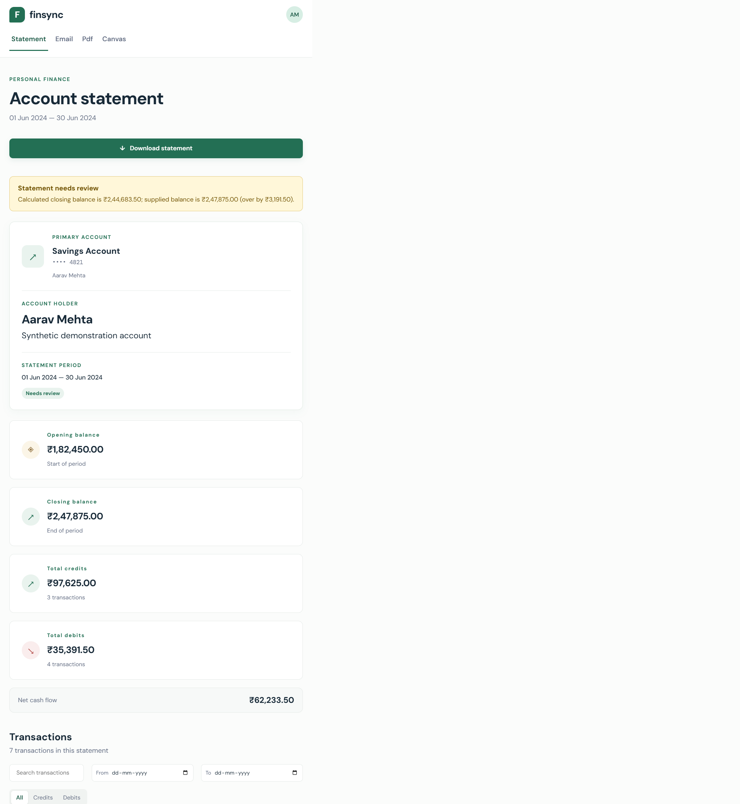
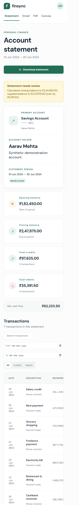
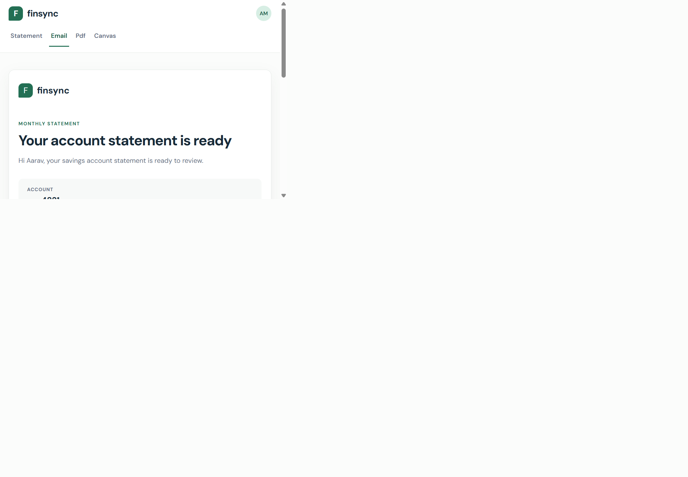
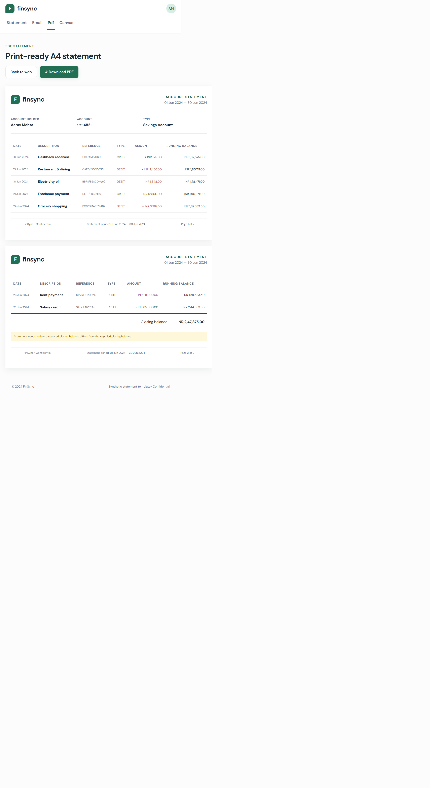
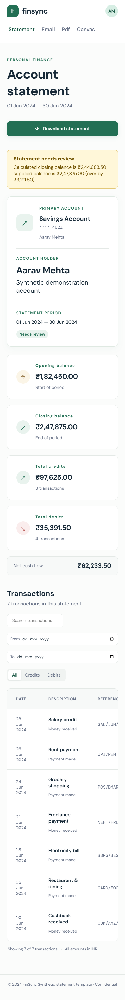

# FinSync

FinSync is a polished React and TypeScript financial statement template built with `@hyper-elements/react@0.5.0`.

It demonstrates one statement dataset across four practical developer-facing formats: an interactive web statement, an email preview, a print-ready PDF, and a shareable canvas summary.

It provides:

- Interactive responsive web statement.
- Email-safe Hyper Elements preview.
- A4 Hyper Elements PDF document preview and export.
- 1200 × 630 Hyper Elements canvas preview and PNG export.
- Integer-paise calculations, reconciliation warnings, account masking, and running balances.

FinSync is a synthetic template, not a banking integration or a regulatory-compliant statement system.

## Install

```powershell
npm install
npm install @hyper-elements/react@0.5.0 @react-pdf/renderer satori @resvg/resvg-js
npm run dev -- --host 127.0.0.1
npm run export
```

Keep the Vite app and export server running separately for PDF and PNG downloads.

## Basic integration

```tsx
import { FinSyncStatement } from './src'
import type { Statement } from './src'

const statement: Statement = {
  accountHolder: 'Meera Shah',
  accountNumber: '•••• 7391',
  accountType: 'Current Account',
  currency: 'INR',
  statementPeriod: { start: '2025-01-01', end: '2025-01-31' },
  openingBalancePaise: 75_000_000,
  closingBalancePaise: 98_050_000,
  transactions: [],
}

export function StatementPage() {
  return <FinSyncStatement statement={statement} initialView="web" />
}
```

For a complete example, see [docs/integration.example.tsx](docs/integration.example.tsx).

## Statement data

`Transaction` requires:

- `id`
- `date` as `YYYY-MM-DD`
- `description`
- `reference`
- `type`: `CREDIT` or `DEBIT`
- `amountPaise`: non-negative safe integer paise
- optional `balancePaise`

`Statement` requires:

- `accountHolder`
- `accountNumber`
- `accountType`
- `currency`: `INR`
- `statementPeriod`
- `openingBalancePaise`
- `closingBalancePaise`
- `transactions`

All money calculations use integer paise. Invalid types, impossible dates, unsafe amounts, duplicate IDs, and outside-period transactions are rejected or reported.

## Theme customization

```tsx
<FinSyncStatement
  statement={statement}
  config={{
    brandName: 'Northstar',
    theme: {
      primaryColor: '#175CD3',
      textColor: '#182A38',
      mutedColor: '#667085',
      surfaceColor: '#FFFFFF',
      subtleSurfaceColor: '#F7F9FC',
      borderColor: '#E4E7EC',
      borderRadius: 8,
    },
  }}
/>
```

Supported public theme keys are primary, text, muted, surface, subtle surface, border, border radius, body font, and mono font.

Supported locales are `en-IN` and `en-US`. The underlying statement model and calculations remain INR-only; arbitrary currency conversion is not implemented.

## Branding

```tsx
<FinSyncStatement
  statement={statement}
  config={{
    brandName: 'Northstar',
    logoUrl: '/northstar.svg',
    logoAlt: 'Northstar',
  }}
/>
```

Logo assets should be local and reliable for exports. Missing or invalid logos fall back to the text/initial brand mark.

## Screenshots

Add genuine application screenshots under [docs/screenshots](docs/screenshots).

The README should link:

- Desktop web statement.
- Mobile web statement.
- Email preview.
- PDF preview.
- Canvas preview.
- One custom-themed statement.








## Privacy

Account numbers are masked by default. Renderers do not expose a public opt-out. Use only synthetic demonstration data.

## Exports

- PDF: local export server with Hyper Elements `renderPdf`.
- PNG: local export server with Hyper Elements `renderImage`.
- Export filenames include the statement period.
- Export failures produce visible error states.

See [docs/EXPORTS.md](docs/EXPORTS.md).

## Verification

```powershell
npm test
npm run lint
npm run build
```
