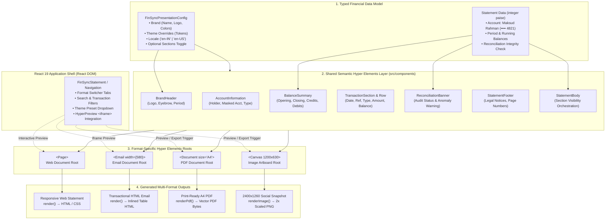

# FinSync

> **Reusable, multi-format financial statement template powered by Hyper Elements.**
> Transform one typed financial statement model into four production-grade outputs: **Responsive Web**, **Transactional Email**, **Print-Ready PDF**, and **Social Canvas**.

Built with **React 19**, **TypeScript**, and **[@hyper-elements/react@0.5.0](https://github.com/hyper-elements/hyper-elements)**. local project: `D:\finsync`.


---

## The Problem & Why Hyper Elements Matters

In modern financial engineering, teams often build and maintain 3–4 disjoint rendering pipelines:
- **Web Dashboards**: React DOM + Tailwind/CSS modules
- **Transactional Notifications**: HTML email tables with inlined CSS (MJML / table markup)
- **Official Print Statements**: Headless browser printing (Puppeteer) or PDF DSLs (`@react-pdf/renderer`)
- **Social & Shareable Summaries**: Satori / Canvas rendering engines

This fragmentation forces developers to duplicate business logic, maintain separate balance calculations, and constantly fix visual discrepancies across channels.

### The FinSync Solution
FinSync demonstrates how **Hyper Elements v0.5.0** eliminates this fragmentation. Developers write semantic financial presentation components **once** (`BrandHeader`, `BalanceSummary`, `TransactionSection`, `AccountInformation`, `ReconciliationBanner`) using Hyper Elements layout primitives (`Row`, `Column`, `Text`, `Heading`, `Table`). FinSync then maps these components into target-specific Hyper Elements roots:
- **`<Page>`**: Compiles via `render()` to responsive Web HTML with scoped styles.
- **`<Email width={580}>`**: Compiles via `render()` to email-client-safe inlined HTML tables.
- **`<Document size="A4">`**: Compiles via `renderPdf()` to vector PDF pages with embedded TrueType fonts.
- **`<Canvas width={1200} height={630}>`**: Compiles via `renderImage()` to high-resolution 2× PNG snapshots.

The result: **one financial dataset and one component model driving four consistent outputs without duplicating presentation logic**.

---

## Output Gallery

FinSync's shared semantic component layer produces four medium-optimized outputs from a single statement input:

| Output Target | Engine & Primitives | Visual Evidence Sample |
| :--- | :--- | :--- |
| **Interactive Web** | `<Page>` via `render()` | [](docs/screenshots/final/web-desktop-1280x1050.png) |
| **Mobile Web** | `<Page>` responsive viewport | [](docs/screenshots/final/web-mobile-390x844.png) |
| **Transactional Email** | `<Email width={580}>` via `render()` | [](docs/screenshots/final/email-preview-640x950.png) |
| **Print-Ready PDF** | `<Document size="A4">` via `renderPdf()` | [](docs/screenshots/final/pdf-preview.png) |
| **Shareable Snapshot** | `<Canvas 1200x630>` via `renderImage()` | [](docs/screenshots/final/canvas-summary-1200x630.png) |
| **Custom Theme Preset** | `<FinSyncStatement>` theme switching | [](docs/screenshots/final/custom-theme.png) |

---

## Architecture: Shared Component Layer

FinSync keeps financial domain logic cleanly separated from rendering targets:



### Shared Component Responsibilities

| Shared Component | Purpose | Reused Across | Medium-Specific Adaptations |
| :--- | :--- | :--- | :--- |
| [`BrandHeader`](src/components/BrandHeader.tsx) | Brand identity, logo, and statement period | Web, Email, PDF, Canvas | `'standard'` for Web; `'email'` with centered metadata; `'compact'` for PDF headers |
| [`AccountInformation`](src/components/AccountInformation.tsx) | Account holder, masked account number, account type | Web, Email, PDF | `'row'` on Web desktop; `'column'` stacked on Email; table-aligned on PDF |
| [`BalanceSummary`](src/components/BalanceSummary.tsx) | Opening, closing, credits, debits, and net cash flow | Web, Email, PDF, Canvas | `'grid'` (2×2 cards) on Web; `'stacked'` rows on Email; `'horizontal'` row on PDF; `'metrics'` on Canvas |
| [`TransactionSection`](src/components/TransactionSection.tsx) | Container for transaction tables and empty states | Web, Email, PDF | Responsive scroll on Web; simplified columns on Email; multi-page pagination on PDF |
| [`TransactionRow`](src/components/TransactionRow.tsx) | Table row for individual ledger entries | Web, Email, PDF | Configurable running balance visibility and positive/negative credit-debit indicators |
| [`ReconciliationBanner`](src/components/ReconciliationBanner.tsx) | Visual warning when arithmetic mismatches | Web, Email, PDF, Canvas | Automatically hidden if statement reconciles; renders red callout if numbers mismatch |
| [`StatementFooter`](src/components/StatementFooter.tsx) | Legal notices, confidentiality, and page numbers | Web, PDF | Supports dynamic `<PageNumber />` and page count in PDF documents |
| [`StatementBody`](src/components/StatementBody.tsx) | Composition root assembling sections | Web, Email | Coordinates optional section toggles (`accountDetails`, `financialSummary`, `transactions`) |

For comprehensive architecture details and layout matrices, see [docs/ARCHITECTURE.md](docs/ARCHITECTURE.md).

---

## Reviewer Quickstart

FinSync requires **Node.js 20+** and **npm 10+**. Follow these exact steps to review the project locally:

### 1. Clean Installation & Verification
In your primary terminal:

```bash
# 1. Clean installation from lockfile
npm ci

# 2. Run test suite (83 automated unit, reconciliation, and renderer tests)
npm test

# 3. Verify linting (0 errors, 0 warnings across 35 files)
npm run lint

# 4. Build production bundle (optimized code splitting, 42 kB application chunk)
npm run build

# 5. Validate Hyper Elements AST trees and inspect export artifacts
npx tsx server/check-exports.ts
```

### 2. Running the Interactive Demo (Terminal 1)
```bash
npm run demo
# or
npm run dev
```
Open **[http://localhost:5173/](http://localhost:5173/)** in your browser:
- Switch between **Statement (Web)**, **Email**, **PDF**, and **Canvas** views.
- Filter transactions by type (**All / Credits / Debits**) and search by keyword or date.
- Switch themes using the **Theme** preset selector in the header.

### 3. Running the Export Server (Terminal 2)
To enable live PDF and PNG downloads in the browser interface, start the export microservice in a second terminal:

```bash
npm run export-server
# or
npm run export
```
The export server will listen at **[http://127.0.0.1:4174](http://127.0.0.1:4174)**. Clicking **↓ Download PDF** or **↓ Download PNG** in the web UI will fetch and download vector PDF and high-resolution PNG documents generated via `@hyper-elements/react/pdf` and `@hyper-elements/react/image`.

---

## Developer Integration & Customization

FinSync is structured as a **source-level developer template** (`"private": true`). External React applications can import FinSync directly from `./src` (or map a monorepo alias e.g. `@/finsync`):

```tsx
import {
  FinSyncStatement,
  type Statement,
  type FinSyncPresentationConfig,
} from './src'

// 1. Supply customer statement data (integer paise arithmetic)
const statement: Statement = {
  accountHolder: 'Maksud Rahman',
  accountNumber: '•••• 4821',
  accountType: 'Savings Account',
  currency: 'INR',
  statementPeriod: { start: '2026-10-01', end: '2026-10-31' },
  openingBalancePaise: 14_280_000, // ₹1,42,800.00
  closingBalancePaise: 18_860_000, // ₹1,88,600.00
  transactions: [
    {
      id: 'txn-01',
      date: '2026-10-05',
      description: 'Consulting services credit',
      reference: 'TXN-2026-004821',
      type: 'CREDIT',
      amountPaise: 6_500_000,
      balancePaise: 20_780_000,
    },
    {
      id: 'txn-02',
      date: '2026-10-14',
      description: 'Health insurance premium',
      reference: 'TXN-2026-004822',
      type: 'DEBIT',
      amountPaise: 1_920_000,
      balancePaise: 18_860_000,
    },
  ],
}

// 2. Custom branding and theme overrides
const config: FinSyncPresentationConfig = {
  brandName: 'Acme Finance',
  logoUrl: '/acme-logo.svg',
  locale: 'en-IN',
  theme: {
    primaryColor: '#0F52BA', // Sapphire Blue brand accent
    borderRadius: 10,
  },
}

// 3. Render the interactive statement
export function CustomerStatementView() {
  return <FinSyncStatement statement={statement} config={config} initialView="web" />
}
```

### Acme Finance Customization Demonstration
A standalone demonstration of custom enterprise branding is provided in [`examples/acme-finance.tsx`](examples/acme-finance.tsx):
- Custom sapphire blue theme identity (`#0F52BA`) with navy ink (`#0B1A2C`).
- Custom vector badge: [`public/acme-logo.svg`](public/acme-logo.svg).
- Document factory exports: `createAcmeWebDocument()`, `createAcmeEmailDocument()`, `createAcmePdfDocument()`, `createAcmeCanvasDocument()`.
- Interactive standalone component: `AcmeInteractiveStatement`.

---

## Financial Data Integrity

FinSync enforces strict mathematical verification across all five non-consecutive synthetic periods (June 2024, March 2025, September 2025, January 2026, October 2026):
1. **Integer Paise Arithmetic**: All transactions, running balances, and totals are computed strictly in integer paise (`1 INR = 100 paise`), eliminating floating-point rounding errors.
2. **Reconciliation Formula**: Verified automatically:
   $$\text{Opening Balance} + \sum \text{Credits} - \sum \text{Debits} = \text{Closing Balance}$$
3. **Audit Visibility**: If an input statement has an arithmetic mismatch, a prominent `ReconciliationBanner` callout is rendered in red across all formats rather than silently falsifying figures.
4. **Intervening Period Gaps**: Non-consecutive statement periods accurately account for intervening net balance changes without assuming artificial continuity.

---

## Technology Stack

- **Framework**: [React 19](https://react.dev) (`react@19.3.1`, `react-dom@19.3.1`)
- **Document Rendering**: [`@hyper-elements/react@0.5.0`](https://github.com/hyper-elements/hyper-elements) (`Page`, `Email`, `Document`, `Canvas`, `render`, `renderPdf`, `renderImage`)
- **Language**: [TypeScript](https://www.typescriptlang.org) (`~7.0.2` / `5.8.x`)
- **Build Tool**: [Vite 8](https://vitejs.dev) with Rollup code-splitting
- **Linter**: [Oxlint](https://oxc-project.github.io) (0 errors, 0 warnings across 35 files)
- **Testing**: [Vitest](https://vitest.dev) (83 passing tests)
- **Typography**: Bundled [Noto Sans Regular & Bold](public/fonts/) (SIL Open Font License)
- **Server**: Node.js reference export server with `@react-pdf/renderer` and `@resvg/resvg-js`

---

## Documentation Index

- [**docs/ARCHITECTURE.md**](docs/ARCHITECTURE.md) — Shared Hyper Elements architecture, data flows, and reuse matrices.
- [**docs/CONFIGURATION.md**](docs/CONFIGURATION.md) — Complete guide on branding, tokens, locales, and optional sections.
- [**docs/EXPORTS.md**](docs/EXPORTS.md) — Export server API reference, curl requests, and deployment boundaries.
- [**docs/integration.example.tsx**](docs/integration.example.tsx) — Production integration example for external applications.
- [**examples/acme-finance.tsx**](examples/acme-finance.tsx) — Standalone Acme Finance customization demo.

---

## Known Boundaries & Synthetic Data Disclaimer

- **Synthetic Data**: All data represents a single synthetic customer identity (**Maksud Rahman**, `•••• 4821`, Savings Account) created specifically for reproducible evaluation. FinSync does not generate authentic bank-issued statements.
- **Currency Model**: Integer paise arithmetic is optimized for Indian Rupees (**INR, ₹**). Multi-currency currency exchange modeling is outside the template scope.
- **Locales**: Tested for `en-IN` (Indian numbering) and `en-US` (thousands numbering). Right-to-left (RTL) scripts are not supported in Hyper Elements v0.5.0.
- **Reference Export Server**: The included export server is a developer reference microservice. In production environments, place export endpoints behind authenticated API gateways with rate-limiting and access quotas.
