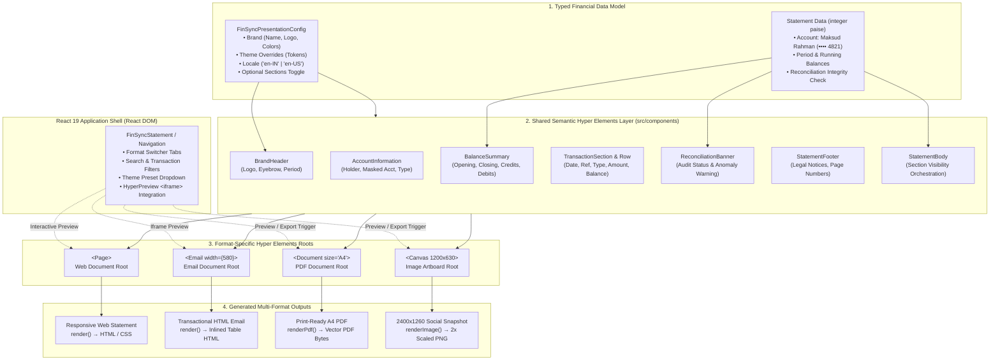

# FinSync Architecture — Shared Hyper Elements Content Layer

FinSync demonstrates how developers can integrate `@hyper-elements/react@0.5.0` to render unified financial statement data across four distinct target formats while respecting each medium's physical constraints.



---

## 1. Shared Content Layer

Rather than duplicating component trees across each renderer, FinSync organizes financial presentation into semantic, Hyper Elements-native components under [`src/components/`](../src/components/):

| Component | Responsibility | Reused In | Format Variants |
|---|---|---|---|
| `BrandHeader` | Renders logo image with text fallback, brand name, eyebrow, and period. | Web, Email, PDF, Canvas | `'standard'` (Web), `'email'` (Email), `'compact'` (PDF/Canvas) |
| `AccountInformation` | Displays account holder, masked account number (`•••• 4821`), and account type. | Web, Email, PDF | `'row'` (Web horizontal), `'column'` (Email stacked), `'pdf'` (PDF table-aligned) |
| `BalanceSummary` | Calculates totals and displays opening balance, closing balance, credits, debits, and net cash flow. | Web, Email, PDF, Canvas | `'grid'` (Web 2×2), `'stacked'` (Email), `'horizontal'` (PDF 5-cell row), `'metrics'` (Canvas 3 cards) |
| `TransactionSection` | Column and Table container rendering headers, rows, and empty state. | Web, Email, PDF | Configurable `showReference`, `showType`, `showRunningBalance`, `fontSize`, `cellPadding` |
| `TransactionRow` | Semantic `<TableRow>` with formatted date, description, type badge, and amount. | Web, Email, PDF | Configurable running balance and credit/debit color indicators |
| `ReconciliationBanner` | Renders a warning callout if opening + credits − debits ≠ closing balance. | Web, Email, PDF, Canvas | Automatically hidden if reconciled; `'standard'`, `'compact'`, `'email'` styles |
| `StatementFooter` | Confidential and synthetic demonstration notices with pagination. | Web, PDF | Optional `<PageNumber />` for PDF |
| `StatementBody` | High-level composition assembling account info, summary, and transactions based on `optionalSections`. | Web, Email | Coordinates section visibility flags |

---

## 2. Reused vs. Format-Specific Adaptations

FinSync avoids superficial write-once claims where medium constraints differ:

### A. Web (`Page`)
- **Shell**: React DOM handles top navigation, theme preset selector, and transaction search/filter tabs.
- **Statement Content**: Rendered via Hyper Elements `<Page>` and `render()`.
- **Adaptation**: Responsive desktop and mobile layout with full transaction filtering.

### B. Email (`Email`)
- **Shell**: Rendered into an iframe preview using `render()`.
- **Statement Content**: Wrapped in `<Email width={560}>` with client-safe typography and inlined tables.
- **Adaptations**:
  - `AccountInformation` uses a stacked `'column'` layout to prevent horizontal overflowing.
  - `BalanceSummary` uses `'stacked'` rows with soft background tints instead of flex cards.
  - Transactions table displays simplified columns (`Date`, `Description`, `Amount`).

### C. PDF (`Document`)
- **Shell**: Served by local export server using `renderPdf()`.
- **Statement Content**: Wrapped in `<Document size="A4">` with SIL Open Font License `Noto Sans`.
- **Adaptations**:
  - Multi-page pagination: transactions are sliced into `Document.Page`s of 10 rows per page.
  - `TransactionSection` displays `Running balance` calculated sequentially in integer paise.
  - `PageHeader` carries `BrandHeader(variant="compact")`; `PageFooter` carries `StatementFooter` with dynamic `<PageNumber />`.
  - Closing summary and reconciliation alerts appear on the final page.

### D. Canvas (`Canvas`)
- **Shell**: Served by local export server using `renderImage()`.
- **Statement Content**: Fixed-dimension social card (`1200 × 630` logical, rendered at 2× scale).
- **Adaptations**:
  - Acts as a financial snapshot rather than an exhaustive document.
  - Reuses `BalanceSummary(variant="metrics")` for high-level Income, Expenses, and Net Cash Flow.
  - Features categorized expense breakdown heuristics rather than a full multi-page table.

---

## 3. Developer Guide: Adding or Customizing a Shared Component

All shared components accept the normalized `Statement` object and `FinSyncRendererConfig`:

```tsx
import { Column, Text } from '@hyper-elements/react'
import { token } from '../theme'
import type { Statement } from '../types'
import type { FinSyncLocale } from '../public-api'

export function CustomStatementNotice({
  statement,
  locale = 'en-IN',
}: {
  statement: Statement
  locale?: FinSyncLocale
}) {
  return (
    <Column
      style={{
        padding: token('spacing.md'),
        backgroundColor: token('colors.surfaceSubtle'),
        borderRadius: token('radii.sm'),
      }}
    >
      <Text style={{ fontSize: 12, color: token('colors.muted') }}>
        Notice for {statement.accountHolder}: All transactions are processed in {statement.currency}.
      </Text>
    </Column>
  )
}
```

Because `token(...)` and Hyper Elements layout primitives are root-agnostic, `CustomStatementNotice` can be inserted directly into `<Page>`, `<Email>`, or `<Document>`.

---

## 4. Hyper Elements Layout Validation & Diagnostics

FinSync separates **financial data validation** (integer arithmetic, date parsing, running balances in `financial.ts`) from **template layout validation** (Hyper Elements AST inspection in `server/check-exports.ts` and test suites).

### Validation APIs in `@hyper-elements/react@0.5.0`
- `validate(element)`: Validates the template against schema constraints without rendering.
- `inspect(element)` (`@hyper-elements/react/inspect`): Analyzes root type, nodes count, applied theme, and diagnostics.
- `formatDiagnostics(diagnostics)`: Generates actionable CLI logs with node paths and suggested fixes.
- `outline(element)`: Produces a structural text outline of the layout tree.

### Diagnostic Example: Missing Theme Tokens
When a component uses `token('colors.primary')` inside a root that lacks a theme definition, Hyper Elements generates a structured diagnostic:

```ts
import { Page, Text, token, validate, formatDiagnostics } from '@hyper-elements/react'

const tree = (
  <Page>
    <Text style={{ color: token('colors.primary') }}>Un-themed text</Text>
  </Page>
)

const result = validate(tree)
console.log(result.valid) // false
console.log(formatDiagnostics(result.diagnostics))
// Output:
// error theme/missing-token at root.children[0].style.color: There's no token "colors.primary": the template has no theme
```

FinSync automatically runs layout validation and node inspection across all four renderers during `npx tsx server/check-exports.ts` and `npm test`.
