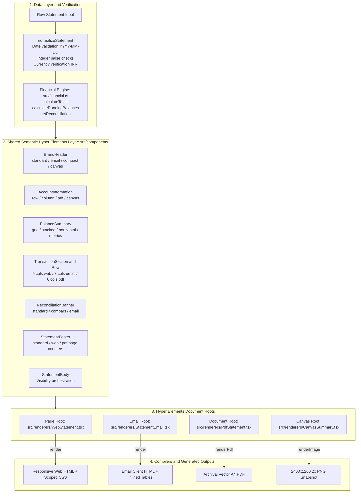
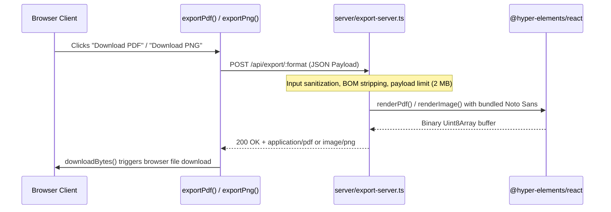

# FinSync Technical Architecture

This document details the internal architecture, design principles, component reuse model, and rendering pipeline of **FinSync**, a multi-format financial statement template built with **React**, **TypeScript**, and **@hyper-elements/react@0.5.0**.

---

## 1. Architectural Philosophy & Design Principles

FinSync resolves the traditional fragmentation of multi-channel financial reporting. Rather than maintaining separate rendering pipelines for web portals, transactional emails, archival PDFs, and preview images, FinSync is structured around three core principles:

1. **Domain Isolation**: Financial ingestion, normalization, and mathematical reconciliation are decoupled from document rendering. Calculation logic is completely agnostic to whether the output is an email or an A4 print document.
2. **Polymorphic Hyper Elements Primitives**: Declarative presentation components (`BrandHeader`, `AccountInformation`, `BalanceSummary`, `TransactionSection`, `ReconciliationBanner`, `StatementFooter`) compose generic Hyper Elements layout blocks (`Row`, `Column`, `Text`, `Heading`, `Table`) that compile across target-specific document roots (`Page`, `Email`, `Document`, `Canvas`).
3. **Respect for Physical Medium Constraints**: Visual consistency does not mean forcing identical layouts across wildly different media. Email requires strict width limits (580px) and MSO table fallbacks; PDF requires discrete A4 pagination (12 rows/page) and vector font embedding; Canvas requires a fixed 1200×630 high-contrast summary grid; Web requires fluid responsive layouts with interactive filtering.

---

## 2. System Architecture Diagram



---

## 3. Financial Data Model & Precision Guarantees

### 3.1 Integer Paise Representation
To eliminate floating-point rounding errors inherent in IEEE 754 arithmetic (such as `0.1 + 0.2 === 0.30000000000000004`), all monetary values in FinSync are strictly represented as non-negative integer paise (`1 INR = 100 paise`):

```ts
export interface Transaction {
  id: string
  date: string             // YYYY-MM-DD
  description: string
  reference: string
  type: 'CREDIT' | 'DEBIT'
  amountPaise: number      // e.g. 6500000 for ₹65,000.00
  balancePaise?: number    // Snapshot running balance
}

export interface Statement {
  accountHolder: string
  accountNumber: string
  accountType: string
  currency: 'INR'
  statementPeriod: {
    start: string          // YYYY-MM-DD
    end: string            // YYYY-MM-DD
  }
  openingBalancePaise: number
  closingBalancePaise: number
  transactions: Transaction[]
}
```

### 3.2 Automated Ledger Reconciliation
The financial engine validates statement balance consistency using the standard banking formula:

$$\text{Expected Closing Balance} = \text{Opening Balance} + \sum \text{Credits} - \sum \text{Debits}$$

If $\Delta = \text{Reported Closing} - \text{Expected Closing} \neq 0$:
- `getReconciliation(statement).valid` evaluates to `false`.
- A red `ReconciliationBanner` renders across all 4 formats detailing the discrepancy.

---

## 4. Hyper Elements Component Reuse Matrix

FinSync maximizes code sharing through variant props without forcing identical layouts:

| Semantic Component | Web (`Page`) | Email (`Email`) | PDF (`Document`) | Canvas (`Canvas`) | Format Adaptation & Rationale |
| :--- | :---: | :---: | :---: | :---: | :--- |
| **`BrandHeader`** | `variant="standard"` | `variant="email"` | `variant="compact"` | `variant="canvas"` | Adapts layout orientation, logo dimensions (24px–32px), and header badge styling. |
| **`AccountInformation`** | `layout="row"` | `layout="column"` | `layout="pdf"` | `layout="canvas"` | Adapts between desktop 2-column card, stacked email table, bordered PDF row, and compact canvas bar. |
| **`BalanceSummary`** | `variant="grid"` | `variant="stacked"` | `variant="horizontal"` | `variant="metrics"` | Polymorphic card container adapting between a 2×2 grid, stacked rows, 5-cell print row, and 3 metric cards. |
| **`TransactionSection`** | Reused (5 cols) | Reused (3 cols) | Reused (6 cols + balance) | *Omitted* | Intentionally omitted on Canvas (1200×630 snapshot medium); shared across all 3 document formats. |
| **`TransactionRow`** | Reused | Reused | Reused | *Omitted* | Renders individual ledger rows with type badges and positive/negative credit-debit styling. |
| **`ReconciliationBanner`**| `variant="standard"` | `variant="email"` | `variant="compact"` | `variant="email"` | Unified mathematical alert callout indicating audit reconciliation status. |
| **`StatementFooter`** | `variant="web"` | *Omitted* | `variant="standard"` | *Omitted* | Reused across full document pages (`Web` and `PDF`). Renders legal notices and dynamic `<PageNumber />` in PDF. |
| **`StatementBody`** | `variant="web"` | `variant="email"` | *Direct pagination* | *Snapshot* | Reused across continuous scroll media (`Web` and `Email`) to coordinate section visibility flags. |

---

## 5. Format-Specific Rendering Implementations

### 5.1 Web Renderer (`src/renderers/WebStatement.tsx`)
- **Document Root**: `<Page>`
- **Compilation**: `render()` compiles the tree into valid HTML with scoped classnames and media queries (`@media (max-width: 640px)`).
- **Interactive Shell Integration**: The web statement renders inside the `StatementPagePreview` wrapper. Host application controls (search inputs, date range pickers, type filters) filter transactions client-side before passing them to `StatementPageDocument`.

### 5.2 Email Renderer (`src/renderers/StatementEmail.tsx`)
- **Document Root**: `<Email width={580}>`
- **Compilation**: `render()` produces table-based HTML markup with inlined CSS styles and Outlook MSO conditional comments.
- **Client Safety**: Avoids unsupported CSS flexbox and grid layouts. Uses stacked key-value blocks in `AccountInformation` and `BalanceSummary` to ensure legibility across mobile mail clients.

### 5.3 PDF Renderer (`src/renderers/PdfStatement.tsx`)
- **Document Root**: `<Document size="A4">`
- **Compilation**: Compiled via `renderPdf()` into an ISO standard A4 PDF document (`210mm × 297mm`).
- **Pagination Strategy**: Transactions are chunked into 12 rows per `Document.Page`. Each page receives a `<PageHeader>` carrying `BrandHeader(variant="compact")` and a `<PageFooter>` carrying `StatementFooter` with dynamic `<PageNumber />` and total page counters.
- **Embedded Typography**: Bundled TrueType fonts (`NotoSans-Regular.ttf` and `NotoSans-Bold.ttf`) are registered with `@hyper-elements/react/pdf`, ensuring identical vector text rendering across host operating systems.

### 5.4 Canvas Renderer (`src/renderers/CanvasSummary.tsx`)
- **Document Root**: `<Canvas width={1200} height={630}>`
- **Compilation**: Compiled via `renderImage()` at 2× scale to generate a 2400×1260 raster PNG.
- **Snapshot Layout**: Designed as an executive financial dashboard card featuring primary opening/closing balances, 3 core financial driver cards (Income, Expenses, Net Flow), and activity breakdown summaries.

---

## 6. Export Pipeline Architecture

The export pipeline supports both browser-driven client downloads and server-side batch generation:



### Security Defenses in Reference Export Server
1. **Payload Size Defense**: Enforces a strict 2 MB JSON body limit to prevent denial-of-service memory exhaustion during rasterization.
2. **Filename Sanitization**: Sanitizes filename parameters using `path.basename` and regex stripping (`[^a-zA-Z0-9_.-]`) to eliminate path traversal vulnerabilities.
3. **CORS & Input Verification**: Rejects malformed statements lacking required account holder, period, or currency fields with descriptive HTTP 400 responses.
